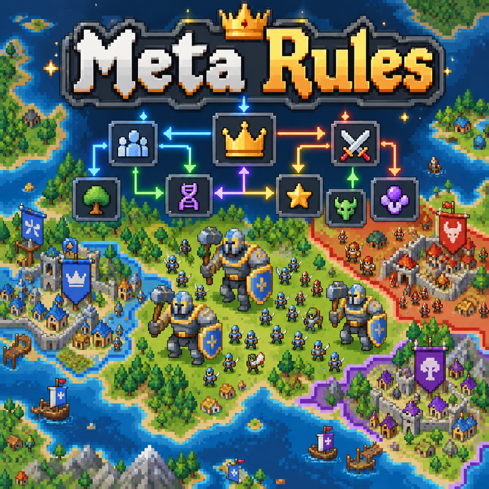

# Meta Rules para WorldBox

Crie regras para **um meta individual**: aquele exército, clã, cultura, religião, cidade, reino, idioma, família ou subespécie. As regras não se aplicam automaticamente a todos os metas do mesmo tipo.

Feito para WorldBox 0.51.2 / build 719 com NeoModLoader. A interface usa janelas e abas do jogo, no estilo do Diplomacy Overhaul, com os devidos créditos pela biblioteca visual MIT.

## Como usar

1. Abra a janela normal de um idioma, reino, cultura ou outro meta específico.
2. Clique na aba **Regras**, com ícone de opções.
3. O editor abre diretamente naquele meta, com seu próprio brasão e nome. **Declarações** e **Exigências** aparecem juntas, sem abas ou lista lateral.

Cada seção tem um botão **+ Adicionar**. Regras usam os ícones nativos de traços, itens e atributos e o brasão real de cada meta. O seletor segue a mesma ordem e os mesmos grupos dos editores de traços e de equipamentos do jogo, com rolagem contínua. A janela tem o tamanho dos editores do jogo e usa a mesma barra de rolagem, os mesmos botões de traços e itens e os brasões nativos. Passe o mouse para ver os nomes; clique em uma regra para editá-la. A busca aparece apenas no seletor ao adicionar uma regra.

### Exigências

Defina quem pode entrar. Cada condição pode exigir um traço ou pertencimento a outro meta específico. Combine TODAS ou QUALQUER condição, com a opção NÃO. Todas as restrições ativas precisam ser atendidas.

Exemplo para a Guarda Imperial:

- Pertence ao clã Casa do Sol.
- Possui o traço Cavaleiro.

As exigências valem para novos membros e para os atuais. Quem não cumprir sai nas próximas atualizações, inclusive ao perder um traço ou vínculo exigido. No exército, isso também vale para o capitão. O exército configurado mantém suas regras se ficar vazio, enquanto seu reino existir.

### Declarações

Defina o que os membros recebem:

- Um traço enquanto pertencerem ao grupo.
- Um traço permanente, que continua após a saída.
- Um equipamento (arma, capacete, armadura, botas, anel ou amuleto), enquanto pertencer ou permanente.
- Entrada em outro grupo: "todo mundo deste reino fala Latim", "todo membro do clã serve neste exército e mora naquela cidade" (idioma, cultura, religião, clã, reino, cidade ou exército). Só acontece quando o jogo permite e sem quebrar nenhuma exigência; mudar de cidade também muda o reino e tira do exército antigo. Família e subespécie não podem ser concedidas.
- Um bônus de vida, dano, armadura, velocidade, velocidade de ataque, inteligência, habilidade militar, diplomacia ou administração enquanto pertencerem.

Exemplo: todos os falantes de um idioma específico recebem um traço; todos os soldados de um exército recebem +10 de armadura.

Traços anteriores ao benefício são preservados. Se vários grupos concedem o mesmo traço temporário, ele só é retirado quando não houver mais fontes ativas. Traços opostos não são apagados para forçar uma declaração. Os bônus de atributos se somam entre grupos, sem acumular a cada atualização.

O equipamento é entregue **uma vez por pertencimento**, substituindo o item daquele espaço (o antigo vai para o depósito da cidade). Se depois a criatura trocar, melhorar ou quebrar o item, o mod não o recria. Ao sair, o item "enquanto pertencer" só é removido se ainda for o mesmo; o permanente fica. Só criaturas que usam itens recebem equipamento; se vários grupos declararem o mesmo espaço, vale o primeiro.

### Membros

A página **Membros** lista as criaturas do meta (com busca; clique no nome para abrir). **Remover** expulsa aquele indivíduo e o mantém fora enquanto as regras estiverem ativas; **Readmitir** desfaz.

### Detalhes e opções

O cabeçalho mostra membros, incompatibilidades e o botão Ativo/Pausado do meta inteiro. Cada regra mostra seus controles (TODAS/ALGUMA, duração, ativada) ao ser aberta; a página **?** explica tudo. Benefícios temporários são retirados nas próximas atualizações; os permanentes continuam.

## Instalação

Extraia o pacote para `worldbox/Mods/MetaRules/`, deixando o `mod.json` diretamente nessa pasta, e reinicie o jogo. O NeoModLoader compila o código ao iniciar.

O idioma acompanha a configuração do jogo: Português (Brasil) — usado também para Português de Portugal — ou inglês; qualquer outro idioma usa o inglês. Regras ficam no próprio save, junto do meta correspondente.

## Limites da primeira versão

- A saída de uma cidade ou reino usa a saída nativa de facção: encerra a cidadania e o serviço militar e devolve o personagem ao seu reino neutro padrão.
- As conquistas primeiro mantêm os moradores no reino da cidade para preservar a coerência do jogo; a elegibilidade é verificada na próxima atualização.
- Uma criatura não pode ficar sem subespécie. Se não cumprir as exigências, só muda para outra subespécie compatível da mesma espécie. Sem alternativa, permanece e aparece como incompatível. A atribuição inicial continua permitida para criar novas criaturas corretamente.
- Declarações de traços e atributos se aplicam aos personagens, e não aos traços do próprio reino, cultura ou idioma.
- O processamento ocorre em lotes; em mundos grandes, mudanças podem levar alguns segundos.
- Compilação e testes do motor foram verificados. O log confirmou o carregamento da versão 0.1.0; a interface e os equipamentos da 0.3.0 ainda precisam ser conferidos em partida.

Consulte o [README em inglês](README.md) para os comandos de desenvolvimento e os detalhes de persistência. Código MIT; os créditos da interface estão em [THIRD_PARTY_NOTICES](THIRD_PARTY_NOTICES).
